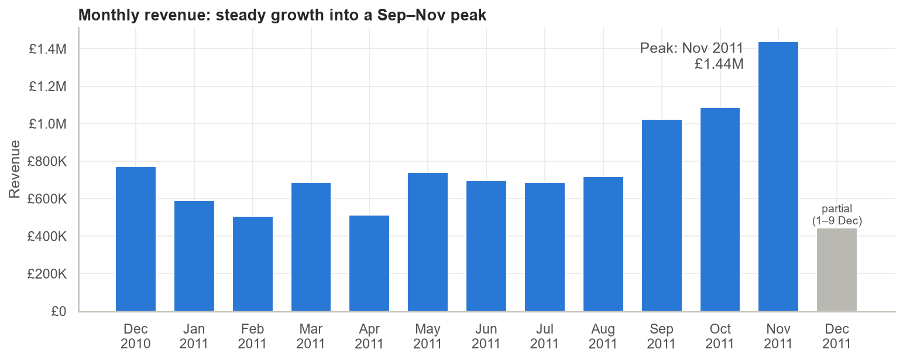
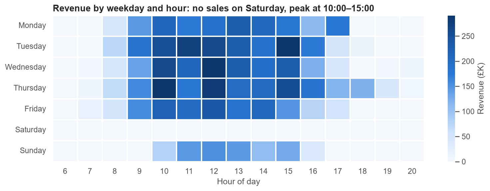
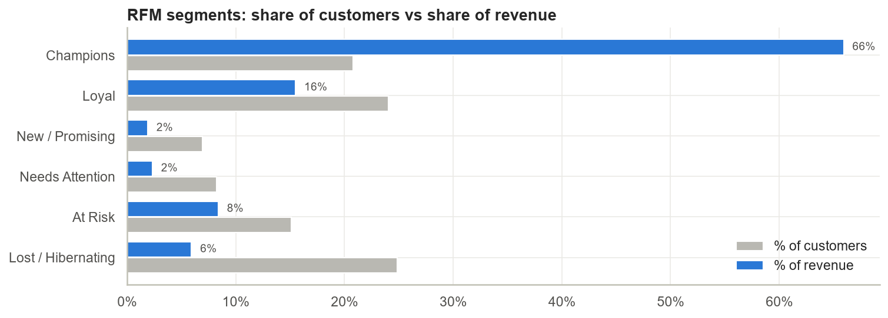
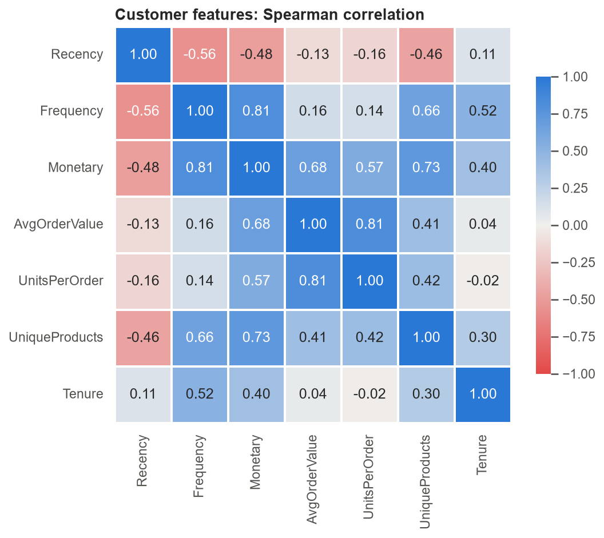
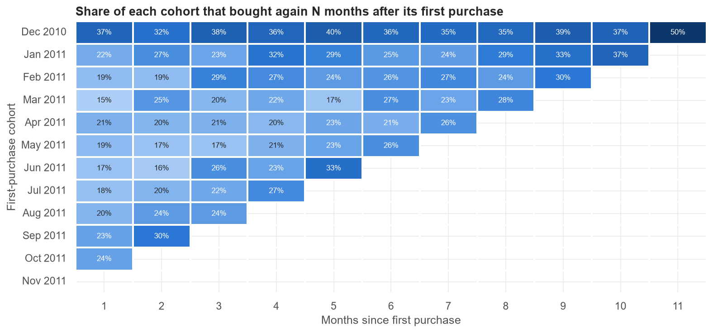

# Exploratory Data Analysis — Online Retail (Python)

A full cleaning and EDA of a **real** transactional dataset: 541,909 lines from a UK online gift retailer, Dec-2010 to Dec-2011.
It is available on [Kaggle](https://www.kaggle.com/datasets/carrie1/ecommerce-data) and originally comes from the
[UCI ML Repository](https://archive.ics.uci.edu/dataset/352/online+retail).

**Tools:** Python, Pandas, NumPy, Matplotlib, Seaborn, Jupyter
**Notebook:** [`eda_online_retail.ipynb`](eda_online_retail.ipynb)

---

## 1. Data cleaning: from 541,909 to 521,819 rows (96.3% kept)

| Step | Rows removed | Reason |
|---|---:|---|
| Exact duplicates | 5,268 | the same line entered twice |
| Cancellations (`C…` invoices) | 9,251 | moved to a separate returns table |
| Non-product codes | 2,406 | postage, Amazon fees, bank charges, manual adjustments |
| Quantity ≤ 0 on normal invoices | 1,324 | stock write-offs ("damages", "check") |
| Unit price ≤ 0 | 1,156 | free samples, bad-debt adjustments |
| Sales reversed within 1 day | 683 | includes two entry errors of 80,995 and 74,215 units |
| Duplicates revealed by name cleaning | 2 | rows that differed only in extra spaces |

Also: product names were trimmed and standardized to one name per stock code (650 codes had several spellings). Rows without a
CustomerID (25% of rows, 16.5% of sales) were **kept** for revenue analysis and excluded only from customer-level analysis.

## 2. Key findings



1. **Strong Q4 seasonality.** September to November brought in 35.8% of the year's revenue.
2. **Growth comes from more customers, not bigger baskets.** From Dec-2010 to Nov-2011, customers grew 88%, while the average order value grew only 5%.
3. **A B2B buying pattern.** No orders on Saturday, 8% of revenue on Sunday, and a weekday peak between 10:00 and 15:00.



4. **The UK brings 85% of revenue.** Abroad, a few wholesale accounts dominate: 9 Dutch customers spent £284K, with an average order of £3,053 (6.5× the UK).
5. **22% of products generate 80% of revenue**, and **the top 20% of customers generate 74%**.
6. **£705K of past spend sits with "At Risk" customers** (RFM segmentation). They used to buy regularly but have been inactive for a median of 134 days.



7. **Spend has two independent drivers**: how *often* a customer buys (ρ = 0.81 with total spend) and how *big* each order is (ρ = 0.81 with units per order). Frequency and order size are almost unrelated (ρ = 0.16).



8. **Retention is the main weakness.** Only about 20% of new customers buy again the next month.



9. **Returns are low (1.8% of sales value) but concentrated**: one product had 59% of its units returned.

## 3. Recommendations

- Plan stock, staff and cash flow for September to November, and order the top 22% of products by August.
- Run a first-purchase follow-up programme. 35% of customers buy only once.
- Win back the 656 At-Risk customers with personal outreach.
- Manage international wholesale accounts as key accounts.
- Review high-return products (quality, photos, descriptions).
- Make CustomerID mandatory, and require confirmation for unusually large orders.

## How to run

```bash
pip install pandas numpy matplotlib seaborn openpyxl jupyter nbformat tabulate
python build_notebook.py        # (re)creates the notebook from its source
jupyter nbconvert --to notebook --execute --inplace eda_online_retail.ipynb
```

The notebook source lives in [`build_notebook.py`](build_notebook.py) so changes are easy to review. Figures are saved to [`figures/`](figures).
