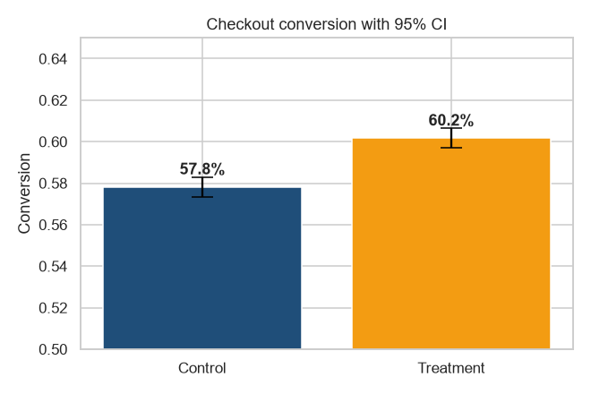

# A/B Test: One-Page Checkout

Did a redesigned single-page checkout increase purchases in a Saudi e-commerce app, and should we ship it?

> **Note:** simulated data for a realistic business scenario (portfolio case study). Client name withheld/fictional.



## What I did
| Step | Method |
|---|---|
| Sample size | Power analysis (Cohen's h, alpha 0.05, power 80%, MDE +1.5 pp) → **16,778 users/group** |
| Data quality | removed 330 users exposed to both variants and 251 bot-like sessions |
| Randomisation check | Sample Ratio Mismatch chi-square (p = 0.5631) |
| Primary metric | two-proportion z-test + Newcombe 95% CI |
| Novelty effect | lift on days 1-3 vs days 4-14 |
| Segments | per device, Bonferroni-corrected |
| Secondary | AOV (Welch + Mann-Whitney), revenue/user (bootstrap CI) |
| Guardrail | payment error rate |

## Results
* Conversion **57.82% → 60.17%** (+2.35 pp, z = 6.9, p < 0.001, 95% CI [1.68, 3.02] pp)
* Novelty: +4.2 pp in the first 3 days, **+1.8 pp steady state**
* Gains on iOS and Android, none on Web; order value unchanged; revenue/user +SAR 7.1
* **Guardrail failed:** payment errors 1.79% → 2.13% (p = 0.0004)
* Worth ≈ **SAR 1,094,460/month** at steady state

**Recommendation:** ship on iOS and Android after fixing the payment step (with a short follow-up test), and keep the old flow on Web.

## How to run
```bash
pip install pandas numpy scipy statsmodels scikit-learn matplotlib seaborn jupyter
jupyter notebook ab_test_checkout.ipynb
```
The notebook is saved **with outputs**, so GitHub renders every table and chart without running anything.

---
© 2026 Ahmed Abdulsalam. All rights reserved. See [LICENSE](../LICENSE).
