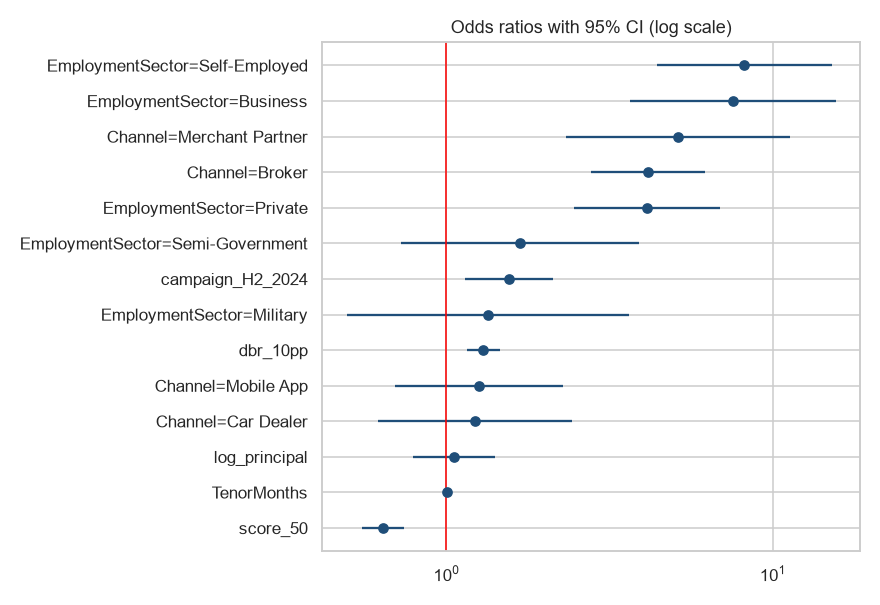

# What Drives Early Default? Logistic Regression

Explaining 12-month early default in a Saudi consumer-finance portfolio (same data as my Power BI credit-risk dashboard), and testing whether a simple model can support approval decisions.

> **Note:** simulated data for a realistic business scenario (portfolio case study). Client name withheld/fictional.



## What I did
* Built the target from 36 monthly performance files: **bad = 90+ DPD or write-off within 12 months on book**, only for loans with a full 12-month window (no right-censoring). 7,347 loans, bad rate 2.78%.
* Univariate tests: chi-square + Cramér's V, Mann-Whitney for credit score.
* Multicollinearity check (max VIF 2.41).
* Multivariable **logistic regression** (statsmodels) → odds ratios with 95% CIs.
* Hold-out evaluation: **AUC 0.8214, Gini 0.6427, KS 0.5054**, decile table, cut-off simulation.

## Key findings (odds ratios, holding other factors constant)
| Factor | Odds ratio |
|---|---|
| +50 credit-score points | 0.64 |
| +10 pp debt-burden ratio | 1.30 |
| Broker vs branch | 4.15 |
| Self-employed vs government | 8.18 |
| H2-2024 growth campaign | 1.56 (p = 0.005) |

The riskiest 20% of applicants contain **62% of defaults**. Declining the worst 10% by model score cuts the bad rate from 2.77% to 1.66%.

*Caveats:* the data is observational (associations, not causation), and the model would need monitoring and a fairness review before any real use.

## How to run
```bash
pip install pandas numpy scipy statsmodels scikit-learn matplotlib seaborn jupyter
jupyter notebook credit_default_drivers.ipynb
```
The notebook is saved **with outputs**, so GitHub renders every table and chart without running anything.
