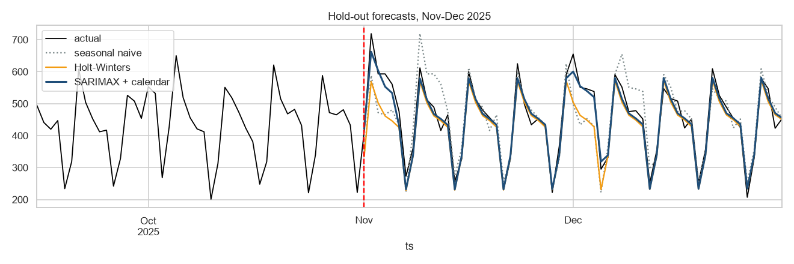
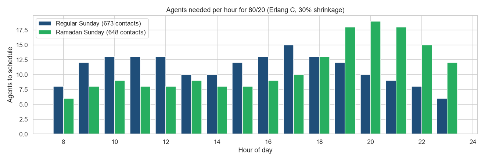

# Contact-Centre Demand Forecasting & Erlang C Staffing

Forecasting daily contacts for a Saudi contact centre (same data as my Power BI contact-centre dashboard) and converting the forecast into **agents per hour** for an 80/20 service level.

> **Note:** simulated data for a realistic business scenario (portfolio case study). Client name withheld/fictional.



## Model comparison (hold-out Nov-Dec 2025)
| Model | MAE | MAPE |
|---|---|---|
| Seasonal naive (benchmark) | 48.5 | 10.5% |
| Holt-Winters | 35.5 | 7.4% |
| **SARIMAX + calendar (Ramadan, billing days)** | **19.5** | **4.5%** |

Residual Ljung-Box p = 0.7426, so no autocorrelation is left in the errors.

## From forecast to roster
* January 2026: ≈ 13,588 contacts. Ramadan 2026: ≈ 489/day.
* **Erlang C** (AHT 395s, 80% within 20s, 30% shrinkage): a regular Sunday peaks at 17:00 with **15 agents**. In Ramadan the peak moves to **20:00** and needs **19 agents**.



## How to run
```bash
pip install pandas numpy scipy statsmodels scikit-learn matplotlib seaborn jupyter
jupyter notebook call_volume_forecast.ipynb
```
The notebook is saved **with outputs**, so GitHub renders every table and chart without running anything.

---
© 2026 Ahmed Abdulsalam. All rights reserved. See [LICENSE](../LICENSE).
